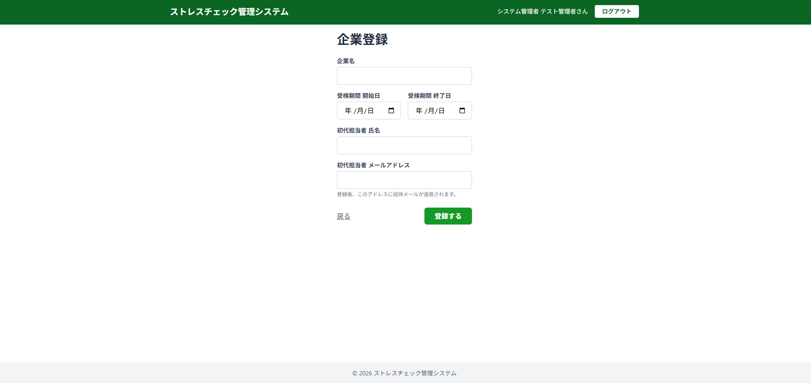
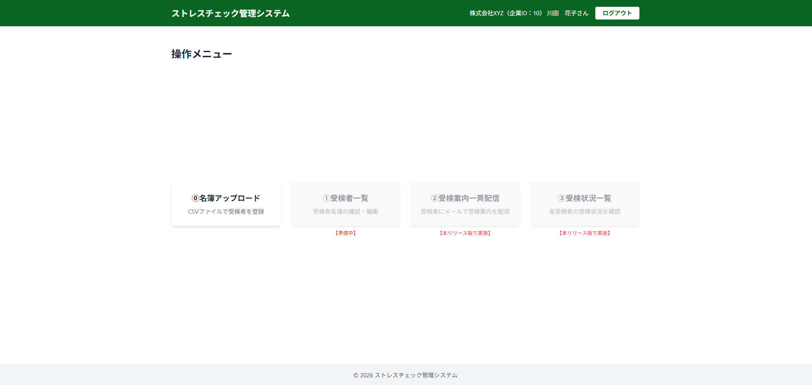
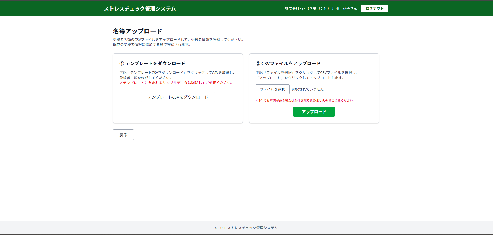
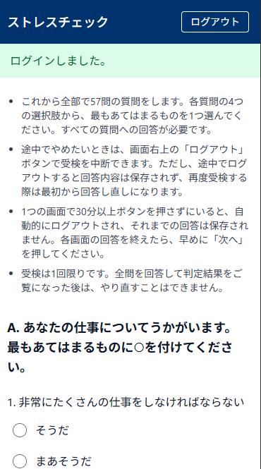
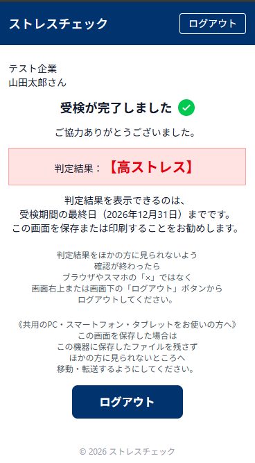
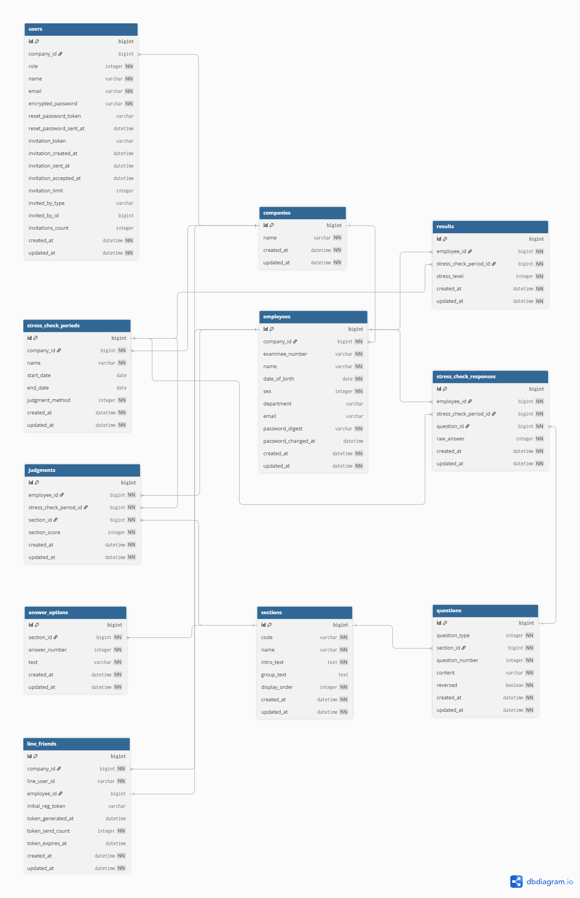

# ストレスチェック
-  本番環境：https://tiishi74b-original-app.onrender.com/

## このアプリについて
-  このストレスチェックアプリは、以下の３種類の方々が使用します。
   -  ①システム管理者
   -  ②企業の担当者
   -  ③各企業の受検者
-  上記①～③は、全て事前にID・パスワード登録した方が利用します。
-  ①②は「システム管理者・企業担当者ログイン」ボタンから、③は「受検者ログイン」ボタンから、それぞれログインします。

## お試し受検について
-  今回、ログイン不要で気軽に受検画面を体験していただけるよう「お試し受検」機能を作りました。トップページ右下の「デモ用お試し受検」ボタンを押して、ぜひ一度試してみてください。
-  お試し受検の回答や結果は保存されません。

---

## 1. サービス概要
-  契約法人の従業員・職員（従業員等）向けストレスチェックサービス
   -  特に、法人から個々の従業員等にパソコンや固有のメールアドレスが付与されていない業種（工場や病院、介護事業所、飲食店、小売業など）に従事する従業員等
-  ストレスチェックは、以下の課題を解決します。
   -  契約法人の従業員等がストレスチェックを定期的に受検することにより、自身のストレス状態を自覚し、ストレス過多によるメンタル不調に陥る前に対処・相談することを促します（一次予防）。
   -  契約法人が、集団分析結果を基に職場改善につなげ、働きやすい職場づくりを進めることによって、従業員等がメンタル不調になることを未然に防止し、かつ、生産性を向上させることを目指します。

（厚生労働省編 2021 労働安全衛生法に基づくストレスチェック制度実施マニュアル, P4を改変：https://www.mhlw.go.jp/content/11300000/001671531.pdf）

---

## 2. このアイデアはどこから生まれたか

### 2-1. きっかけとなった体験・感情
-  ストレスチェック（Web受検）は、ログインするためのID・パスワードを各受検者のメールアドレスに通知して、オフィスにある受検者自身のPCで受検することが一般的です。
-  しかし、工場勤務の方や、病院の病棟で勤務する看護師、介護事業所で勤務する介護スタッフ、飲食店などの店舗で接客をしている方々は、業務上、各従業員専用のPCを使用する必要性が乏しいため、法人からPCを支給されていないことが多い状況です。
-  また、個々にメールアドレスを付与されていないことが多く、ID・パスワードを通知することができないことがほとんどです。
-  このため、ID＝従業員ID、パスワード＝生年月日YYYYMMDDなどで設定することが多く、近年、各法人で高まっているセキュリティレベルを満たさない状況かと思います。
-  また、各従業員にメールアドレスが付与されていないため、受検期間中にメールを配信して受検を促す（受検勧奨）することもできず、法人の担当者は、各部署の管理職を通じて未受検者に受検を促していることが多い状況であり、法人担当者の負担は大きいと思われます。
-  このようなことから、以下の要件を満たすアプリを制作したいと思いました。
   1.  法人から個別に支給されたPCが無くてもスマホやタブレットで受検できる。
   2.  メールアドレスがなくてもスマホアプリやLINEに通知が届く。

---

### 2-2. なぜそれが「気になった」のか
-  勤務先の複数の契約法人の担当者から、スマホ受検できないか、と実際に照会を受けたことがあるため。
-  経験上、メールアドレスが無い受検者に対しては、契約法人の管理職を通して未受検者に受検を促さざるを得ず、契約法人の担当者に負担となっていたため。
   -  加えて、高ストレス者に対する医師面接の申出を促したい場合は、管理職を通して促してしまうと「高ストレス者」であることを管理職が知ることとなり、法令に抵触することになります。\
      その結果、管理職を通じた医師面接の申出勧奨が行えないことになり、結果として高ストレス者に対する医師面接の申出が増えない状況にあります。

---

## 3. 課題の整理（表面的になっていないか）

### 3-1. 表に見えている困りごと
-  メールアドレスのない受検者にログイン用ID・パスワードを届けることが難しい状況です。
-  受検勧奨などの勧奨をメール配信することによって行うことができず、契約法人の担当者の負担になっています。
-  スマホで受検することができず、結果画面がきれいに表示されない不具合をよく経験しました。

---

### 3-2. 本当に解決したい課題は何か
-  スマホやスマホのLINEでストレスチェックを手軽に受けられることによる、受検環境へのアクセスの向上
-  メールアドレスによる通知機能に加えて、スマホアプリやLINEでの通知機能を活用することによる、企業担当者による受検勧奨や実施者による医師面接申出勧奨の負担軽減

---

## 4. 想定ユーザーについて

### 4-1. 想定しているユーザー
- 契約法人の従業員等
  -  特に、法人から個々の従業員等にパソコンや固有のメールアドレスが付与されていない業種（工場や病院、介護事業所、飲食店、小売業など）に従事する従業員等

---

### 4-2. 自分とユーザーの距離
-  サービス提供者と顧客

### 4-3. 実際に使われる可能性について(需要・存在確認)
-  今回のターゲット層は、従来はマークシートによる紙受検を主に行っていた層です。
-  紙受検に代えてスマホ受検・LINE受検かつ通知が受け取れる機能を実装することにより、既存事業者との差別化を図ることができるかと思います。

### 4-4. ユーザーがサービスを導入して利用するまでのイメージ(導入・継続の流れ)
-  契約法人の担当者（人事や健康管理室のスタッフ）から各従業員等に向けた周知によって利用します。
-  各従業員等（受検者）は、初期登録を行います。各従業員等の初期登録状況を契約法人の担当者は常に把握できます。
-  ストレスチェックは法人契約となるため、契約法人が契約を続ける限り各受検者による利用は続きます。
   -  このアプリの利点は、受検者の受検しやすさを最も考慮したいと思っています。このため、受検しやすいアプリを制作することにより、従業員等の支持を得て、契約法人が契約を続けることを目指します。

-  このアプリの以下の特徴によって、多くの企業に利用してもらうことを目指します。
   -  受検者の受検しやすさ（スマホ受検・LINE受検）
   -  メールアドレスのない受検者に対しても受検勧奨通知を配信できること
   -  受検者管理が容易であること
   -  最終的には、医師面接のサービスを含めたパッケージ提供を想定しており、ストレスチェック業務をワンストップで対応できること

- 情報管理・個人情報の保護対策
  -  プライバシーマークの取得を予定しています（法人での起業を予定）。

- 契約を広げるためのハードル
  1.  認知（そもそも知られていない）
  2.  信用・安心感
  3.  企業側担当者による、乗り換え検討～契約～乗り換え手続きにかかる手間・時間

## 5. 既存サービス・競合調査

### 5-1. 似たサービスの調査
- サービス名：アドバンテッジ・タフネス
   -  （株式会社アドバンテッジ・リスクマネジメント）
   - URL：https://www.armg.jp/mhlw/at/
   - どんなことができるか：ストレスチェック受検（スマホ受検・Web受検・紙受検）、集団分析

- サービス名：ストレスチェック
   -  （株式会社ドクタートラスト）
   - URL：https://www.stresscheck-dt.jp/?_gl=1*x4k7je*_gcl_au*MTcwMDA4OTEyOS4xNzgxNjkwMzM0
   - どんなことができるか：ストレスチェック受検（スマホ受検・Web受検・紙受検）、集団分析

- サービス名：ORIZIN
   -  （株式会社ドリームホップ）
   - URL：https://lp.dreamhop.com/orizin/
   - どんなことができるか：ストレスチェック受検（スマホ受検・Web受検・紙受検）、集団分析

---

### 5-2. それでも自分が作りたい理由
-  上記の３社ともに、受検者（契約法人の従業員等）の受検しやすさが追及されていないと思います。スマホ受検ができる場合であっても、通知がスマホ（スマホアプリ）に届くのか、それとも、ただのスマホのWeb画面で受検するのかが明らかではないです。
-  上記３社ともに、LINE受検可能とは記載されていません。
-  上記３社ともに「集団分析」をウリにしていますが、経験上、特殊な分析を求めている法人はごく少数です。その他の法人では、集団分析は参考程度としていることが多いです。
-  ストレスチェック結果が高ストレスとなり、医師面接を申し出た場合は、当該法人は速やかに医師面接をその従業員等に受けさせる義務が生じますが、この医師面接までサービスに入れている企業は少ないようです。

### 5-3. 差別化を一文で決める
-  どこでも、漏れなく、どのような働く人でも受検しやすいアプリを目指します！

---

## 6. このサービスで提供したい価値

### 6-1. ユーザーの変化
-  想定されるユーザーの変化
   -  気持ち：カンタン
   -  行動：とにかく受検してみる
   -  考え方：自身のストレス状況に気づくようになる。

### 6-2. 価値を一文で表す
-  どこでも、漏れなく、どのような働く人でも受検しやすいアプリを目指します！

---

## 7. このアプリで実現すること

### MVPで作る機能
※ 機能の末尾の表記について
-  表記なし：実装済み（MVP版）
-  【MVP版で追加実装予定】：MVP の範囲で、これから追加する機能（受検者名簿の編集・追加、企業情報の編集など）
-  【本リリース版で実装予定】：商用での運用に向けて実装する機能

1.  受検者
    -  Webで完結する初期登録画面【本リリース版で実装予定】
       -  MVP版では、企業ID・受検者番号・初期パスワード（生年月日）で初回ログイン
    -  Web画面（PCおよびスマホ）
    -  認証による受検者アカウントのログイン（企業ID・受検者番号・パスワード）
       -  初回ログイン時に強制パスワード変更
       -  57問版ストレスチェック受検（全問4択式）
       -  単純合計法による高ストレス判定
       -  高ストレス、低ストレス別の結果表示
    -  一定時間（1画面30分）操作がない場合の自動ログアウト（セッションタイムアウト）
    -  ログイン不要の「お試し受検」（回答・結果は保存しません）
2.  企業担当者
    -  受検者名簿登録画面・UL
       -  ULは追加のみ（登録済みの名簿に追加する形）
       -  「新規」（登録済名簿を削除＋追加）・「更新」（登録済名簿の変更＋追加）・「削除」（削除対象の名簿）の各ULは【本リリース版で実装予定】
       -  登録済み名簿のDLは【本リリース版で実装予定】
    -  受検者一覧・個別編集・個別削除【MVP版で追加実装予定】
    -  企業IDを埋め込んだLINE友達追加用QRコード自動生成【本リリース版で実装予定】
    -  LINE登録した受検者にLINEメッセージでランダムトークン付き「初期登録URL」送信【本リリース版で実装予定】
    -  初期登録した受検者情報とLINEユーザーIDを紐づける機能【本リリース版で実装予定】
    -  受検案内通知・受検勧奨通知【本リリース版で実装予定】
    -  ※MVPでは、企業担当者は受検状況（未受検・受検済み）の把握、受検結果の閲覧はできません。
    &emsp;受検結果閲覧機能は、本リリース版で「実施者」「実施事務従事者」に付与されます（企業担当者には付与しません）。
       -  受検状況の確認は【本リリース版で実装予定】
3.  システム管理者
    -  企業登録画面
    -  企業情報の編集・削除【MVP版で追加実装予定】

#### MVP版の画面イメージ

**システム管理者：企業登録画面**

**企業担当者：操作メニュー**

**企業担当者：名簿アップロード画面**

**受検者：受検画面・結果表示画面（スマホ）**

  
  

### 本リリースで作る機能
1.  以下の権限別にアカウント発行·閲覧·編集画面設定
    1.  受検者
        -  受検-結果画面
        -  医師面接申出画面
        -  結果提供同意画面（またはボタン）
        -  ダッシュボード

    2.  企業担当者
        -  名簿登録画面（UL+DL）
        -  結果通知設定画面（ストレスチェック結果自体を後日表示する場合に、結果表示可能になったことを通知する設定画面）
        -  高ストレス者申出設定画面
        -  通知送信画面（メール・LINEメッセージ）
           -  受検案内
           -  受検勧奨
        -  ダッシュボード
           -  リアルタイムの受検済者数
           -  受検対象者数
           -  リアルタイムの受検率（①÷②×100％）
           -  高ストレス者率
           -  医師面接申出者一覧画面・一覧DL
           -  集団分析画面

    3.  実施事務従事者
        -  上記（２）の全て
        -  各受検者の受検結果画面・結果DL（エクセルまたはCSV）
        -  通知送信画面（医師面接案内メール、医師面接勧奨メール）
        -  集団分析画面

    4.  実施者
        -  実施事務従事者と同じ

    5.  システム管理者
        -  上記３の全て
        -  受検設定画面〔57問版・80問版、高ストレス判定基準設定（単純合計法・素点換算表）〕
        -  （企業別）企業担当者/実施事務従事者/実施者登録・一覧・DL、受検情報/受検結果提供同意設定画面
        -  メール送信機能（担当者アカウント発行メール）
        -  システム管理者登録画面・一覧DL
        -  企業登録画面・一覧DL
        -  集団分析画面

    【備考】企業担当者・実施事務従事者・実施者について
    -  企業担当者：契約法人の人事担当者〔人事権のある担当者（課長級以上）を想定〕。個人の受検結果（高ストレス判定・医師面接対象有無を含む）の閲覧は法令上禁止されている。
    -  実施事務従事者：契約企業の人事担当者〔人事権のない担当者（係長級以下）を想定〕。実施者の指示に基づき名簿登録等企業側の運用事務を行う。個人の受検結果（同上）は運用事務上必要なため法令上認められている。
    -  実施者：契約法人のストレスチェック実施の責任者。医師、保健師、研修を修了した看護師・精神保健福祉士・公認心理師等が担当。医師面接対象有無を判定する。個人の受検結果（同上）は法令上認められている。

2.  操作環境など
    -  レスポンシブ対応（スマホ受検）
    -  スマホアプリ作成（初期登録・受検開始/勧奨/医師面接案内/医師面接勧奨通知。その他の機能はクリックするとWeb画面に遷移）
    -  LINE受検

## 8. このアプリの懸念点とその対策
-  本リリース版の機能が盛りだくさん過ぎて、自分では開発できないのではないか。
   -  ⇒コアな機能から順次開発する。
-  固有のメールアドレスを持たない受検者がスマホアプリやLINE登録をする際の、初期登録設定フローが不明瞭
   -  ⇒初期登録の際に、どのようにすれば「成りすまし」の可能性を排除して初期登録してもらうことができるのか。
   -  MVP版では、企業が登録した名簿の情報（企業ID・受検者番号・生年月日）で初回ログインし、初回ログイン時にパスワードを強制的に変更する方式にした。
   -  スマホアプリやLINEを使った初期登録の方式は【本リリース版で実装予定】。

## 9. 今後の展開・発展の方向性
-  このアプリをベースに起業したいと思っています。

### 今考えている発展案
-  外国語対応（多言語化）
-  特定業界（例えば介護業界）に特化した販売・実施・データ集積。特に特定業界に特化したストレスチェック結果が蓄積されることにより、集団分析結果を出力する際、その業界平均との差を出力でき、販売時の強力な特徴となることが期待できます。

## 10. 技術スタック（手段としての技術）

### 10-1. 使用技術

-  開発言語：Ruby 3.4.13
-  フレームワーク：Ruby on Rails 7.2.3.2（7.2.4 への更新、8.1 へのアップグレードを予定）
-  データベース：PostgreSQL 15
-  デプロイ先：Render
-  開発環境：Docker
-  認証：Devise（システム管理者・企業担当者）、has_secure_password（受検者）
-  CSS／UIフレームワーク：Tailwind CSS v4（tailwindcss-rails）
-  メール配信：Gmail SMTP（本番環境）、letter_opener_web（開発環境）
-  その他ライブラリ／Gem
   -  招待メール：devise_invitable
   -  Devise の日本語化：devise-i18n
   -  CSV 名簿の読み込み：csv
   -  テスト：RSpec、FactoryBot
   -  コード品質：RuboCop（ルール：rubocop-rails-omakase）
   -  CI：GitHub Actions（RuboCop、JavaScript の脆弱性チェック。RSpec の自動実行は今後設定予定）
   -  検索機能：Ransack【MVP版で追加実装予定】
   -  ページネーション：kaminari【MVP版で追加実装予定】
   -  権限別設定：Pundit【MVP版で追加実装予定】
-  LINE関連【本リリース版で実装予定】
   -  プッシュメッセージ送信：LINE Messaging API
   -  RailsからLINE APIを呼ぶためのRuby Gem：line-bot-api
   -  LINEからの友だち追加イベントを受け取る：Webhook受信
   -  企業IDをQRコードに埋め込む仕組み：URLパラメータ付き友だち追加リンク
   -  ローカル開発でLINE Webhookを受け取るための一時公開：ngrok
   -  QRコード生成：rqrcode

---

### 10-2. 技術選定の理由
-  Ruby on Rails：フルスタック・フレームワークのため、フロント部分とバックエンド部分を同一フレームワークで開発できる。このため、小規模な個人開発に向いているため。

- 今回の開発で意欲的に取り組みたい点
  -  スマホアプリによる通知機能【本リリース版で実装予定】
  -  LINE受検【本リリース版で実装予定】

- 不安な点
  -  本当に自分に開発できるかが不安

## 11. ER図

## 12. 設計で工夫したところ

### 12-1. 受検者のログインを、Devise とは別の仕組みにした
-  システム管理者・企業担当者は Devise（メールアドレス・パスワード）でログインするが、受検者は Devise を使わず、`has_secure_password` でログイン機能を作った。
-  理由：受検者は、法人からメールアドレスを付与されていないことを前提にしているため、メールアドレスでログインする Devise の仕組みが合わない。
-  受検者は「企業ID・受検者番号・パスワード」でログインする。受検者番号は企業ごとに付けるため、企業IDとの組み合わせで受検者を特定する。
-  初期パスワードは生年月日（8桁）。推測されやすいため、初回ログイン時に必ず変更してもらう。

### 12-2. 企業担当者は、受検者個人の結果を見られない設計にした
-  個人の結果は、労働安全衛生法により、本人の同意なく事業者（企業）に提供することが禁止されている。
-  このため、企業担当者は受検者個人の結果を見られない設計にした。

### 12-3. 回答は「セッション」に預け、送信時にまとめてDBに保存する
-  回答データは、質問画面（A～D：計4画面）ごとに「セッション」に「預ける」。「戻る」を押したときも回答を同様に「セッション」に預ける。
   -  ここでいう「セッション」は、Rails の標準の仕組みで、受検者のブラウザの Cookie に暗号化して保存される小さなデータです（DB には保存しません）。
-  全問の回答が終わり、「回答を送信する」ボタンを押したときにDBに保存される。あわせて、セクション別の点数の計算と、高ストレスの判定を行う。
-  1問ごと（または1画面ごと）にDBへ保存しない理由
   -  MVPでは途中保存（中断・再開）を行わないため、途中の回答をDBに残す必要がない。
   -  途中の回答をDBに保存すると、全問そろっていない「歯抜け」の回答がDBに残り、「受検済みかどうか」や判定の扱いが複雑になる。
   -  その代わり、ログアウトや30分のタイムアウトでセッションが消えると、回答も消える。このため、受検画面の注意事項でその旨を案内している。

### 12-4. 共用の機器で、ほかの人に結果を見られないようにした
-  1つの画面で30分以上操作がないと、自動でログアウトする。
-  結果表示画面に、「×」で閉じるのではなく「ログアウト」ボタンを押すことと、共用のPC・スマートフォン・タブレットを使う方への案内を入れた。

### 12-5. 「お試し受検」は、回答・結果をDBに保存しない
-  デモであっても、不必要に結果が残るとアプリ自体への信頼が下がるため、回答・判定結果はDBに保存しないようにした。
-  本リリース版でも、見込み客向けのデモンストレーションとして、機能自体は残す予定。

最終更新：2026年11月21日（土）
